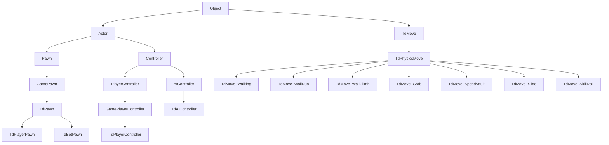

# Mirror's Edge: UnrealScript (`TdGame.u`) Gameplay Architecture & Class Reverse Engineering

## Executive Summary & Architecture Overview

Mirror's Edge runs on a customized build of **Unreal Engine 3** (Engine Version 3716, Cooked Content Version 60, Package File Version 536/43). Gameplay logic, player parkour mechanics, enemy combat AI, weapon handling, HUD rendering, and level scripting reside in cooked script packages located in `TdGame/CookedPC/`:

| Package | Classes | Exports | Purpose |
| :--- | :--- | :--- | :--- |
| `Core.u` | 8 | 1,274 | Unreal Engine base object system (`Object`, `Component`, `DistributionFloat`, etc.) |
| `Engine.u` | 1,115 | 25,282 | Core engine framework (`Actor`, `Pawn`, `PlayerController`, `Volume`, `SkeletalMesh`) |
| `GameFramework.u` | 12 | 161 | Epic base gameplay extension classes (`GamePawn`, `GameWeapon`, `GamePlayerInput`) |
| **`TdGame.u`** | **916** | **52,410** | **Mirror's Edge core gameplay runtime: parkour state machine, Faith pawn, AI, Kismet** |
| `TdSharedContent.u` | 15 | 188 | Firearms & ordnance definitions (Colt 1911, MP5K, Remington 870, Barrett M95, etc.) |
| `TdSpContent.u` | 16 | 169 | Single-player campaign enemy bot pawns (Patrol Cop, SWAT, Riot, Pursuit, Gunner) |
| `TdSpBossContent.u`| 2 | 34 | Boss encounter pawns (`TdBotPawn_Celeste`, `TdBotPawn_SniperCeleste`) |
| `TdTTContent.u` | 7 | 103 | Time Trial mode logic (`TdGhostPawn`, `TdHUDContentTimeTrial`, announcer messages) |
| `TdTuContent.u` | 3 | 39 | Tutorial challenge framework (`TdHUDContentTutorial`, feedback messages) |
| `TdMenuContent.u` | 1 | 2 | Main menu interface HUD content (`TdHUDContentMainMenu`) |

The package format uses standard UE3 package serialization (`0x9E2A83C1`), compressed with **LZO1X** in 128KB chunks. When decompressed, `TdGame.u` expands from 29.3 MB to **56.16 MB** containing 20,592 names, 2,246 imports, and 52,410 exports.

---

## Complete Class Hierarchy & Gameplay Systems



---

## Movement System & Parkour State Machine

### 1. `EMovement` Enum & `MoveClasses` Mapping

In `TdPawn`, the current player move is tracked by `MovementState` and `OldMovementState` of type `EMovement` (95 enum entries). Each enum value maps directly to an index in `TdPawn.MoveClasses`, which holds the class archetype for that move:

| ID | Enum Value | Class (`MoveClasses[ID]`) | Base Class | Physics State | Key Purpose / Mechanic |
| :---: | :--- | :--- | :--- | :--- | :--- |
| `0` | `MOVE_None` | `None` | - | `PHYS_None` | Uninitialized / invalid move |
| `1` | `MOVE_Walking` | `TdMove_Walking` | `TdPhysicsMove` | `PHYS_Walking` | Standard jogging, running, and sprinting ground locomotion |
| `2` | `MOVE_Falling` | `TdMove_Falling` | `TdPhysicsMove` | `PHYS_Falling` | Air state after leaving ground without vaulting/jumping |
| `3` | `MOVE_Grabbing` | `TdMove_Grab` | `TdPhysicsMove` | `PHYS_Flying` | Hanging from a ledge, pipe, or sign board |
| `4` | `MOVE_WallRunningRight` | `TdMove_WallRun` | `TdPhysicsMove` | `PHYS_WallRunning` | Right wall horizontal traversal (tilt 15°, friction 0.15) |
| `5` | `MOVE_WallRunningLeft` | `TdMove_WallRun` | `TdPhysicsMove` | `PHYS_WallRunning` | Left wall horizontal traversal |
| `6` | `MOVE_WallClimbing` | `TdMove_WallClimb` | `TdPhysicsMove` | `PHYS_WallClimbing` | Vertical wall climb (up to 320 units Z add-on velocity) |
| `7` | `MOVE_SpringBoarding` | `TdMove_SpringBoard`| `TdPhysicsMove` | `PHYS_Falling` | Launching off low obstacle (dumpster/vent) to gain height |
| `8` | `MOVE_SpeedVaulting` | `TdMove_SpeedVault` | `TdPhysicsMove` | `PHYS_Flying` | Fast momentum-preserving one-hand vault over railings |
| `9` | `MOVE_VaultOver` | `TdMove_VaultOver` | `TdMove_SpeedVault` | `PHYS_Flying` | Two-handed vault over thicker obstacles or tables |
| `10` | `MOVE_GrabPullUp` | `TdMove_GrabPullUp` | `TdPhysicsMove` | `PHYS_Flying` | Climbing up from ledge hang to standing position: the heave's root motion moves the pawn (`HangHeaveUp` 1.533 s, Root +186.5 up / +67.8 forward; `HangFreeHeaveUp` 2.0 s) along the facing it started with, collision off (`bDisableCollision`) until `EnableCollision` at 1.4 s, `ReleaseCamera` at 0.8 s, ends with the animation (`MODLOG.md` §30) |
| `11` | `MOVE_Jump` | `TdMove_Jump` | `TdPhysicsMove` | `PHYS_Falling` | Standard ground jump with speed-dependent vertical impulse |
| `12` | `MOVE_WallRunJump` | `TdMove_WallrunJump`| `TdPhysicsMove` | `PHYS_Falling` | Angled leap off a wallrun across a gap |
| `13` | `MOVE_GrabJump` | `TdMove_GrabJump` | `TdPhysicsMove` | `PHYS_Falling` | Leap backward or sideways from a hanging ledge |
| `14` | `MOVE_IntoGrab` | `TdMove_IntoGrab` | `TdPhysicsMove` | `PHYS_Flying` | Pre-grab alignment and reach phase before full hang |
| `15` | `MOVE_Crouch` | `TdMove_Crouch` | `TdPhysicsMove` | `PHYS_Walking` | Crouched ground locomotion (height scale 0.40) |
| `16` | `MOVE_Slide` | `TdMove_Slide` | `TdMove` | `PHYS_Walking` | Low-friction sprint slide under pipes/fences |
| `17` | `MOVE_Melee` | `TdMove_Melee` | `TdMove_MeleeBase` | `PHYS_Walking` | Standing / running punch-kick attack combo |
| `18` | `MOVE_Snatch` | `TdMOVE_Disarm` | `TdPhysicsMove` | `PHYS_Flying` | Weapon disarm QTE maneuver on enemy guards |
| `19` | `MOVE_Barge` | `TdMove_Barge` | `TdPhysicsMove` | `PHYS_Walking` | Shoulder bash through heavy closed doors |
| `20` | `MOVE_Landing` | `TdMove_Landing` | `TdMove` | `PHYS_Walking` | Heavy hard landing with momentum stall from extreme height |
| `21` | `MOVE_Climb` | `TdMove_Climb` | `TdPhysicsMove` | `PHYS_Flying` | Climbing vertical ladders or pipes |
| `22` | `MOVE_IntoClimb` | `TdMove_IntoClimb` | `TdPhysicsMove` | `PHYS_Flying` | Ladder/pipe mounting alignment |
| `23` | `MOVE_WallKick` | `TdMove_Disabled` | `TdPhysicsMove` | `PHYS_Falling` | Obsolete kick off wall (disabled in final release) |
| `24` | `MOVE_180Turn` | `TdMove_180Turn` | `TdMove` | `PHYS_Walking` | Ground quick-turn 180° rotation |
| `25` | `MOVE_180TurnInAir` | `TdMove_180TurnInAir` | `TdPhysicsMove` | `PHYS_Falling` | Mid-air 180° quick spin for wall-to-ledge jump |
| `26` | `MOVE_LayOnGround` | `TdMove_LayOnGround`| `TdPhysicsMove` | `PHYS_Walking` | Knocked down / recovery state after heavy explosion or punch |
| `27` | `MOVE_IntoZipLine` | `TdMove_IntoZipLine`| `TdPhysicsMove` | `PHYS_Flying` | Zipline grab and cable-snapping alignment |
| `28` | `MOVE_ZipLine` | `TdMove_ZipLine` | `TdPhysicsMove` | `PHYS_Flying` | Fast gravity slide down zipline cables |
| `29` | `MOVE_Balance` | `TdMove_Balance` | `TdPhysicsMove` | `PHYS_Walking` | Walking across narrow planks/pipes with balance tilt |
| `30` | `MOVE_LedgeWalk` | `TdMove_LedgeWalk` | `TdPhysicsMove` | `PHYS_Walking` | Shuffling along narrow wall ledges (shimmying) |
| `31` | `MOVE_GrabTransfer` | `TdMove_GrabTransfer` | `TdPhysicsMove` | `PHYS_Flying` | Traversing around corners while hanging on a ledge |
| `32` | `MOVE_MeleeAir` | `TdMove_MeleeAir` | `TdMove_MeleeBase` | `PHYS_Falling` | Jump kick in mid-air |
| `33` | `MOVE_DodgeJump` | `TdMove_DodgeJump` | `TdPhysicsMove` | `PHYS_Falling` | Lateral dodge leap |
| `34` | `MOVE_WallRunDodgeJump` | `TdMove_WallrunDodgeJump` | `TdPhysicsMove` | `PHYS_Falling` | Sideways kick-off from wallrun |
| `35` | `MOVE_Stumble` | `TdMove_Stumble` | `TdMove_StumbleBase` | `PHYS_Walking` | Light stagger after taking non-lethal impact |
| `36` | `MOVE_Snatched` | `TdMove_Disarmed` | `TdPhysicsMove` | `PHYS_Flying` | State applied to victim being disarmed |
| `37` | `MOVE_StepUp` | `TdMove_StepUp` | `TdPhysicsMove` | `PHYS_Walking` | Auto step-up over low curbs (height < 35 units) |
| `38` | `MOVE_RumpSlide` | `TdMove_RumpSlide` | `TdPhysicsMove` | `PHYS_Walking` | Sliding down steep metal/glass roof slopes on bottom |
| `39` | `MOVE_Interact` | `TdMove_Interact` | `TdPhysicsMove` | `PHYS_Walking` | Pressing buttons, opening valve wheels, pulling levers |
| `40` | `MOVE_WallRun` | `TdMove_WallRun` | `TdPhysicsMove` | `PHYS_WallRunning` | General base class for wallrun physics |
| `47` | `MOVE_Vertigo` | `TdMove_Vertigo` | `TdPhysicsMove` | `PHYS_Walking` | Camera vertigo sway when looking over sheer roof edge |
| `48` | `MOVE_MeleeSlide` | `TdMove_MeleeSlide`| `TdMove_MeleeBase` | `PHYS_Walking` | Low sweep kick during ground slide |
| `49` | `MOVE_WallClimbDodgeJump` | `TdMove_WallClimbDodgeJump` | `TdPhysicsMove` | `PHYS_Falling` | Lateral leap away from vertical wall climb |
| `50` | `MOVE_WallClimb180TurnJump` | `TdMove_WallClimb180TurnJump` | `TdPhysicsMove` | `PHYS_Falling` | Turn-and-jump off vertical climb to reach behind |
| `51` | `MOVE_WallClimbDodgeJumpLeft` | `TdMove_WallClimbDodgeJump` | `TdPhysicsMove` | `PHYS_Falling` | Wall climb push-off to the left |
| `52` | `MOVE_WallClimbDodgeJumpRight`| `TdMove_WallClimbDodgeJump` | `TdPhysicsMove` | `PHYS_Falling` | Wall climb push-off to the right |
| `53` | `MOVE_MeleeVault` | `TdMove_MeleeVault`| `TdMove_MeleeBase` | `PHYS_Flying` | Flying kick over an obstacle directly into an enemy |
| `55` | `MOVE_StumbleHard` | `TdMove_StumbleHard` | `TdMove_Stumble` | `PHYS_Walking` | Violent backward stumble from shotgun/melee blast |
| `56` | `MOVE_BotRoll` | `TdMove_BotRoll` | `TdMove` | `PHYS_Walking` | AI tactical roll |
| `60` | `MOVE_Swing` | `TdMove_Swing` | `TdPhysicsMove` | `PHYS_Flying` | Horizontal bar swinging (momentum accumulation) |
| `61` | `MOVE_Coil` | `TdMove_Coil` | `TdPhysicsMove` | `PHYS_Falling` | Tucking legs up during mid-air jump over razor wire |
| `62` | `MOVE_MeleeWallrun` | `TdMove_MeleeWallrun` | `TdMove_MeleeBase` | `PHYS_WallRunning` | Dropping from wallrun with high-velocity kick |
| `63` | `MOVE_MeleeCrouch` | `TdMove_MeleeCrouch` | `TdMove_MeleeBase` | `PHYS_Walking` | Crouch uppercut punch |
| `71` | `MOVE_MeleeBarge` | `TdMove_Disabled` | `TdMove_MeleeBase` | `PHYS_Walking` | Heavy door kick (merged into `TdMove_Barge`) |
| `72` | `MOVE_FallingUncontrolled` | `TdMove_FallingUncontrolled` | `TdPhysicsMove` | `PHYS_Falling` | Terminal velocity freefall with wind rush sound |
| `73` | `MOVE_SwingJump` | `TdMove_SwingJump` | `TdPhysicsMove` | `PHYS_Falling` | Release launch from horizontal swing bar |
| `74` | `MOVE_AnimationPlayback` | `TdMove_AnimationPlayback` | `TdMove` | `PHYS_Custom` | Scripted cutscene root-motion animation player |
| `78` | `MOVE_SoftLanding` | `TdMove_SoftLanding`| `TdPhysicsMove` | `PHYS_Walking` | Fluid knee-bend landing maintaining jogging speed |
| `81` | `MOVE_AutoStepUp` | `TdMove_AutoStepUp`| `TdPhysicsMove` | `PHYS_Walking` | Smooth ledge step without breaking sprint |
| `82` | `MOVE_MeleeAirAbove` | `TdMove_MeleeAirAbove` | `TdMove_MeleeBase` | `PHYS_Falling` | Aerial takedown stomp onto enemy below |
| `85` | `MOVE_AirBarge` | `TdMove_AirBarge` | `TdMove_Barge` | `PHYS_Falling` | Mid-air flying shoulder barge into door/window |
| `91` | `MOVE_SkillRoll` | `TdMove_SkillRoll` | `TdPhysicsMove` | `PHYS_Walking` | Forward roll on landing (crouch within 0.2 s of touchdown): `fallinglandroll` on root motion (313.5 uu, 1.27 s) with a full camera somersault, then `MOVE_Walking` |
| `93` | `MOVE_Cutscene` | `TdMove_Cutscene` | `TdPhysicsMove` | `PHYS_None` | Interactive cutscene state (e.g. elevator escape) |

---

### 2. Core Move Transition State Machine

Every tick, `TdPawn` coordinates with `TdMoveManager` and the active `TdMove`:

```
Input / Environment Trace
          │
          ▼
   CanDoMove(NewMove) ──[False]──> Keep Current Move
          │
       [True]
          ▼
   SetMove(NewMove)
          │
          ├──> Moves[OldMove].StopMove()
          │         └── PostStopMove()
          │
          ├──> MovementState = NewMove
          │
          └──> Moves[NewMove].StartMove()
                    ├── SetCustomCollisionSize()
                    ├── SetPawnPhysics(PawnPhysics)
                    ├── PlayMoveAnim()
                    └── SetSwanNeckConstraints()
```

#### Key Transition Logic:
- **`CanDoMove(NewMove, bCheckOnly)`**: Checks `bAllowMoveChange`, validates move bounds, checks cooldown timers (`LastStopMoveTime`), and executes `Moves[NewMove].CanDoMove()`.
- **`StartMove()`**: Configures collision radius/height (e.g. shrinking cylinder during slide or crouch), locks/unlocks camera pitch/yaw constraints, blends first-person skeletal mesh animations, and enables or disables root motion.
- **`StopMove()`**: Restores base cylinder collision (`Radius=30.0`, `Height=90.0`), resets camera swan-neck offsets, and triggers transition to `MOVE_Walking` or `MOVE_Falling`.

---

### 3. Environmental Trace & Detection Logic

Mirror's Edge uses specialized ray and box traces to detect interactive geometry without manual trigger volumes:

```
                  [Eye Level] ────────── Trace Forward (350 units)
                       │                       │
                       │                       ▼
                       │                 [Wall Detected]
                       │                       │
    [Ledge Trace] ─────┴──────── Box Trace Down (Height / Depth)
                       │                       │
                       ▼                       ▼
            Ledge Found (MinZ=0.707)    CheckForWallRun (Angle 45°-85°)
                       │                       │
                       ▼                       ▼
                  MOVE_Grab            MOVE_WallRunning
```

- **`CheckForGrab()`**: Casts forward trace from eye (`LedgeFindDistance = 350.0`, `LedgeFindDepth = 4.0`), followed by vertical downward trace to detect top surface normal (`MinLedgeZNormal = 0.707`, corresponding to max 45° slope).
- **`CheckForVaultOver()`**: Runs forward box trace at waist level. If obstacle height is between 40 and 110 units and obstacle thickness is < 150 units, triggers `MOVE_SpeedVault` (if sprinting) or `MOVE_VaultOver` (if jogging).
- **`CheckForWallRun()`**: Measures player angle against wall normal. If angle is between 45° and 85°, player speed is > 300 units/s, and wall height is > 180 units, triggers `MOVE_WallRunningRight` or `MOVE_WallRunningLeft`.
- **`CheckForWallClimb()`**: Forward impact angle < 30° from wall normal at speed > 100 units/s initiates vertical climb with up to 320 units/s Z-velocity boost.
- **`CheckForSpringBoard()`**: Traces for low objects (height 50–90 units). If jumped into within 0.15s of contact, adds vertical launch impulse.

---

### 4. Locomotion Physics & Momentum Formulas

Ground locomotion uses dynamic velocity interpolation depending on input state and forward flow:

```
               0          50         260         400              630
Velocity (u/s) ├───Sneak───┼───Walk───┼────Jog────┼──────Run───────┼─────Sprint─────>
               │           │          │           │                │
               ▼           ▼          ▼           ▼                ▼
           Crouch/Pipe  Normal Walk  Base Run   Full Momentum   Max Flow / Glaze
```

- **Sneak Velocity**: `5.0 units/s`
- **Walk Velocity**: `50.0 units/s`
- **Jog Velocity**: `260.0 units/s`
- **Run Velocity**: `400.0 units/s`
- **Sprint Velocity**: `630.0 units/s` (Max sprint achieved after 3.0s uninterrupted run)
- **Air Speed**: `2400.0 units/s`
- **Air Control**: `0.025`
- **Acceleration Rate**: `6144.0 units/s²`
- **Momentum Deceleration On Turn**: `SpeedTurnDecelerationFactor = 10.0`
- **Sprint Acceleration Factor**: `SpeedSprintVelocityAccelerationFactor = 30.0`
- **Energy Deceleration Time**: `SpeedEnergyDecelerationTime = 3.0s`, `Exponent = 0.5`
- **Wall Step Max Height**: `MaxWallStepHeight = 35.0 units`

---

### 5. Health, Damage & Regeneration System

Faith has a regenerating health pool managed in `TdPawn` and `TdPlayerPawn`:

- **Maximum Health**: `100.0`
- **Regenerate Delay**: `5.000s` (Health regeneration starts after 5 seconds without taking damage)
- **Regenerate Health Rate**: `25.000 HP/s` (Full recovery from 1 HP to 100 HP takes 4 seconds)
- **Stun Recovery Rate**: `10.0 units/s`
- **Taser Recovery Rate**: `50.0 units/s`
- **Falling Damage Threshold**: `FallingUncontrolledHeight = 1000.0 units`. Falls beyond this without skill roll result in fatal impact. Performing `TdMove_SkillRoll` replaces the landing: `StartMove` zeroes Velocity and Acceleration and the pawn rolls on `fallinglandroll`'s root motion (313.5 uu forward over 1.27 s), leaving at the animation's ~233 uu/s exit speed.
- **Armour** (`TdPawn.AdjustDamage`): a bullet's damage on her is `Max(0, int(Damage * (1 - Armor)))` with `ArmorBulletsHeadSettings` = `...BodySettings` = `...LegsSettings` = 0.7 / 0.5 / 0.3 at Easy / Medium / Hard (`DefaultGame.ini`, `[TdGame.TdPlayerPawn]`): which part of her is hit changes nothing. A bot's armour, the head's doubling on a bot and what a bot's bullet is before her armour are in "Combat between the player and the bots" below.

---

### 6. Runner Vision & Red Target Coloring

Runner Vision highlights parkour-traversable objects in vibrant red:

- **Look-At Points (`TdLookAtPoint`)**: Placed throughout levels with `LookAtInterpolationTimer = 0.1s` and `LookAtDurationTimer = 0.5s`. Pressing the Look-At button smoothly blends camera rotation toward the next critical route objective.
- **Red Material Highlighting (`TdRedTarget`)**: Dynamic material instance swapping where `bIsInteractive` objects (doors, pipes, springboards, ziplines) interpolate parameter `HighlightAmount` from 0.0 (white/neutral) to 1.0 (Runner Red) as the player approaches within 1500 units.
- **Color Gradients**: Uses post-process color grading (`TdFakePostProcessEffect`) to desaturate world surroundings while saturating red and cyan channels.

---

### 7. Reaction Time (Bullet Time Slow-Motion)

- **Spawn Level**: `ReactionTimeSpawnLevel = 99.9` (Starts fully charged)
- **Energy Drain Rate**: `ReactionTimeDrain = 8.0 units/s` (~12.5 seconds max duration)
- **Maximum Time Dilation**: `ReactionTimeMaxEffect = 0.250` (Slows game world to 25% speed; Faith moves relatively faster)
- **Fade In Rate**: `ReactionTimeFadeIn = 90.0/s`
- **Fade Out Rate**: `ReactionTimeFadeOut = 20.0/s`
- **Energy Recharge**: Builds up by maintaining flow, chaining moves, and performing disarms.

---

## Weapons & Combat Architecture

Weapon definitions in `TdSharedContent.u` derive from `TdWeapon_Light` or `TdWeapon_Heavy`:

| Weapon Class | Real-World Model | Category | Ammo | Equip (s) | Reload (s) | Range (u) | Recoil | Damage |
| :--- | :--- | :--- | :---: | :---: | :---: | :---: | :---: | :---: |
| `TdWeapon_Pistol_Colt1911` | Colt M1911 .45 ACP | Light | 8 | 0.75 | 2.0 | 4,500 | 2.0 | 42 |
| `TdWeapon_Pistol_Glock18c` | Glock 18C 9mm Auto | Light | 33 | 0.60 | 1.8 | 4,500 | 1.8 | 17 |
| `TdWeapon_Pistol_BerettaM93R` | Beretta 93R Burst | Light | 21 | 0.65 | 1.9 | 4,500 | 2.2 | 19 |
| `TdWeapon_Pistol_DE05` | Desert Eagle .50 AE | Light | 12 | 0.85 | 2.2 | 12,000 | 4.5 | 90 |
| `TdWeapon_Pistol_TaserContent` | Taser X26 | Light | 10 | 0.70 | 2.5 | 1,000 | 0.5 | 10 (`TdDmgType_Taser`) |
| `TdWeapon_AssaultRifle_MP5K` | H&K MP5K 9mm | Heavy | 30 | 0.90 | 2.4 | 8,000 | 2.8 | 25 |
| `TdWeapon_SMG_SteyrTMP` | Steyr TMP 9mm | Light | 30 | 0.70 | 2.0 | 3,000 | 2.5 | 15.5 |
| `TdWeapon_AssaultRifle_HKG36` | H&K G36C 5.56mm | Heavy | 30 | 1.00 | 2.5 | 9,000 | 3.2 | 30 |
| `TdWeapon_AssaultRifle_FNSCARL`| FN SCAR-L 5.56mm | Heavy | 30 | 1.00 | 2.6 | 9,000 | 3.0 | 35 |
| `TdWeapon_Shotgun_Remington870`| Remington 870 12ga | Heavy | 7 | 1.10 | 3.5 | 6,000 | 5.5 | 10x16 |
| `TdWeapon_Shotgun_Neostead` | Neostead 2000 12ga | Heavy | 12 | 1.15 | 3.8 | 6,000 | 5.2 | 10x16 |
| `TdWeapon_Sniper_BarretM95` | Barrett M95 .50 BMG | Heavy | 20 | 1.40 | 4.0 | 20,000 | 8.0 | 100 |
| `TdWeapon_Machinegun_FNMinimi` | FN Minimi 5.56mm LMG | Heavy | 99 | 1.50 | 5.0 | 20,000 | 3.8 | 36 |

The Ammo, Range and Damage columns are the classes' own defaults as read out of `TdSharedContent.u` (`MaxAmmo`, `WeaponRange`, `InstantHitDamage` in single player; a value a class does not write is `TdWeapon`'s: 33 rounds, 12,000 uu). `DefaultWeapons.ini`'s `Damages`, `FallOffDistances` and `Ranges` by difficulty are all 0, which `TdWeapon.SetDifficultyLevel` takes as "the class's own". The other columns were not read again. What a bot does with each weapon (its fall-off, spread, bursts) is in "Combat between the player and the bots" below.

### Combat Mechanics:
- **Speed Penalty**: Carrying light weapons scales speed to 0.9x (`SpeedCurve_LightWeapon`); heavy weapons scale speed to 0.7x (`SpeedCurve_HeavyWeapon`) and disable wallruns and vertical climbs.
- **Dropping Weapons**: Weapons cannot be holstered or reloaded by Faith; when empty, they are thrown away or dropped via `DropWeapon()`.

---

## AI & Bot Archetypes

`TdBotPawn` and `TdAIController` drive enemies with tactical squad roles:

1. **Patrol Cop (`TdBotPawn_PatrolCop`, `_PatrolCop_Steyr`, `_PatrolCop_Remington`)**: Light armor, armed with the Colt 1911 (`AITemplate_PatrolCop`, `PatrolCop2`, `PatrolCop3`), the Glock 18c, the Steyr TMP or the Remington 870 by template. Vulnerable to frontal slide-kick and instant disarm.
2. **Pursuit Cop (`TdBotPawn_PursuitCop`)**: Agile runner cops capable of parkour (`TdMove_BotMelee`, `TdMove_BotRoll`, `TdMove_BotJump`). Cannot be outrun in straight line; must be countered with slide kicks or environment traps.
3. **Riot Cop (`TdBotPawn_RiotCop`)**: Wears impact armor and riot helmet. Armed with the Steyr TMP (`AITemplate_RiotCop`'s `MainWeaponClass`) in his right hand and a riot shield in his left (below, "The riot cop's shield"). Can be disarmed only from behind.
4. **SWAT / Assault (`TdBotPawn_Assault`)**: Armed with the FN SCAR-L (`AITemplate_Assault`), the MP5K, the G36 or the Neostead by template. Uses squad cover tactics (`SeqAct_SetCoverGroup`) and bounding fire.
5. **Heavy / Support (`TdBotPawn_Support`)**: Wears full explosive armor, armed with FN Minimi LMG. Slow turn rate; vulnerable only from behind.
6. **Bosses**:
   - **Celeste (`TdBotPawn_Celeste`)**: Fast runner boss with exclusive counter-moves (`TdMove_Melee_BossCeleste`, `TdMove_HeadButtedByCeleste`, `SeqEvt_TdCelesteBossFight`).
   - **Jackknife (`TdBotPawn_JKSniper`)**: Sniper boss encounter with blind aiming spot mechanics (`SeqAct_AISetSniperBlindAimSpot`).

---

## Combat between the player and the bots

Read out of `TdGame.u`'s bytecode, `MirrorsEdge.exe` (the addresses below), `DefaultAITemplates.ini`, `DefaultWeapons.ini`, `DefaultGame.ini`, `DefaultAI.ini` and the class defaults of `TdSharedContent.u`, `TdSpContent.u` and `TdSpBossContent.u`. The research, with a second reader's verdict on every claim, is in the main checkout's ignored `build/re/open2/botfire/` (`notes.md`, `verify.md`). In the port every rule and table of this section is in `src/physics/bot_fire.hpp`; `ParkourController::update_ai_bots` and `update_combat_and_weapons` apply them; `MODLOG.md` section 45 has what was checked.

### 1. A bot's shot at the player: the aim bot

A bot does not roll a die for each shot. His controller owns a `TdAimBot` that keeps an aim offset, in uu at her place, and the offset shrinks while he sees her.

- **The three values.** `BaseOffset` (how far to her side the bullets are aimed), `BaseDispersion` (how much further, at random) and `BaseYOffset` (how far under her eyes). `UTdAimBot::UpdateDispersion` (0x012537f0), every tick: with an enemy, each goes up by the one-shot penalty of the move she has just changed to (`ATdPawn` vtbl[0x458]: `Moves[MovementState].AiAimOneShotPenalty` on the tick `MovementState` is not `AIAimOldMovementState`); while `EnemyVisible` and the bot is not suppressed (`Suppression >= 0`, 0x011e7f90) each goes down by `GetImprovementRate() * DeltaTime`; then each is clamped: `BaseOffset` to `[HorizontalOffset_Min, HorizontalOffset_Max[band]]`, `BaseDispersion` to `[Dispersion_Min, Dispersion_Max]`, `BaseYOffset` to `[VerticalOffset_Min, VerticalOffset_Max]`. It improves whether or not he is firing, and nothing makes it worse with time: out of his sight it stops.
- **The rate** (`UTdAimBot::GetImprovementRate`, 0x01252610): the template's `ImprovementRates_Near / _Medium / _Far` for the band at the difficulty, times `MoveTowardMultiplier` while her speed on the level is 200 uu/s or less; faster, by the cosine `d` between her velocity and the direction from her to the bot: `|d| < 0.7` `MoveSidewaysMultiplier`, else `d < 0` `MoveAwayMultiplier`, else `MoveTowardMultiplier`; and, when the result is above nothing, times the `AiAimPenalty` of the move she is in (vtbl[0x454]). An overridden rate (`OverriddenImprovementRate`, set by Kismet's `SeqAct_TdAIPerfectAim` with an `AccuracyImprovementRate` other than 0) replaces all of it.
- **The band** (`ATdBotPawn::ClassifyAIFiringRange`, 0x01236340): far when the distance is over the weapon's `CombatRange_Max`, near under 489.9 uu (240000 squared), else medium. `CombatRange_Min` is read by nothing.
- **Where a shot is aimed** (`TdAIController.GetAdjustedAimFor` -> `TdAimBot.GetAimLocation(Enemy, bFirstShot)`). On the first shot `StartBurst`: the three values are thrown to their most (`BaseOffset = HorizontalOffset_Max[band]`) and `PickPoint` picks `CurrentX = Offset + sign(Offset) * BaseDispersion * FRand()` to her side and `CurrentY = (her eyes' height over her Location) - FRand() * BaseYOffset`, to one side or the other at random when she stands still, with `TargetX = -CurrentX`. `Offset` (`GetDispersionOffset`) is `BaseOffset`, more by `HorizontalOffset_Max * speed / top speed` when she crosses his view at 200 uu/s or more, to the side her yaw says. On every later shot `GetNextLocation` moves the point across her by `MovementRate_Horizontal * (CurrentX - TargetX) * (time since the last shot)`, a quarter more or less at random, and up at `MovementRate_Vertical` towards her eyes; across and far enough out, a new `PickPoint`. The point is `X` uu to the side of the line from the bot to her and `Y` over her `Location` (`GetOffsetPoint`). So a stream of bullets sweeps over her from one side to the other, and most of the early ones pass her.
- **`bFirstShot` is set again whenever the bot has no line of fire** (`TdAIController` vtbl[0x3f0], 0x011ea200: `bHasLineOfFire = EnemyVisible || KeepFiringTime + EnemyNotVisibleTimeStamp > now || suppression fire`; `TdAIController.EnemyNotVisible` draws `KeepFiringTime` between the weapon's `MinKeepFiringTime` 0.2 and `MaxKeepFiringTime` 0.8). Breaking his line of sight for longer than that gives her his worst aim back.
- **The line** (`Weapon.InstantFire`): from `TdBotPawn.GetWeaponStartTraceLocation` (the bone `RightHandIndex2`) through the aim point, with the weapon's `Spread` on top (`Weapon.AddSpread`), `WeaponRange` long, with no extent. It can meet her only in the bodies of `CH_TKY_Crim_Fixer.Faith3p_Physics` on her third-person mesh (21 bodies: 17 fixed to the skeleton, 4 of her hair that hang free; her cylinders and her first-person mesh stop no such line), and it stops in another bot's bodies with nothing coming of it (`TdBotPawn.TakeDamage` wants the player behind the shot).
- **The gate** (`TdPlayerPawn.TakeDamage`'s first statement -> `TdAimBot.IsHitRelevant`): a pistol's, a rifle's or a shotgun's bullet that landed on her does nothing, and is not heard, while `BaseOffset > OffsetThreshold[band]`. A sniper's bullet and a taser always count; so do the Training Area's partner's hits (`TdAI_Tutorial.IsHitRelevant`) and those of a bot whose aim bot is the `TdAimBot_Perfect` (`SeqAct_TdAIPerfectAim` with a rate of 0), which also aims at her `Location` itself. Whether a hit on her is heard is `TdWeapon.PlayImpactEffects`' own test: `IsHitRelevant(TdDmgType_LowCaliber_Bullet)`, a fixed class, so a sniper's bullet that counts is not heard while his `BaseOffset` is over the threshold. The partner (`TdAI_Tutorial`) fires nothing at her in the first place: its `SeePlayer` does nothing, so she is never his `Enemy`, and its one combat state is `CombatTutorialMelee` (entered from `TestCombatTransitions` when `CanAttack`: `bAttackInitiated`, set by the level's `SeqAct_TdAiInitiateAttack`, the tutorial listener's `CanAttack` and her in `MOVE_Walking`).
- **The damage** (`TdWeapon.GetInstantHitDamage`, `TdPawn.AdjustDamage`): `InstantHitDamage`, between `FallOffDistance` and `WeaponRange` lessened by the weapon's kind of fall-off (`t` the part of that stretch covered: linear `* (1 - t)`, inverse `/ (3t + 1)`), nothing from `WeaponRange` on, times `AIDamageMultiplier`, to an int; then her armour: `int(that * (1 - 0.7 / 0.5 / 0.3))` at Easy / Medium / Hard. Her health comes back at 25 a second from 5 s after the last damage.
- **No move makes her immune.** A move slows the aim or throws it back:

| Her move | `AiAimPenalty` (Easy / Medium / Hard; multiplies the rate) | `AiAimOneShotPenalty` (uu, on entering it) |
|---|---|---|
| Wall run, wall climb | 0.4 / 0.5 / 0.7 | 0 |
| Springboard | 0.3 / 0.4 / 0.6 | 75 |
| Speed vault, vault over | 1 | 50 |
| Jump | 0.7 / 0.8 / 1.0 | 0 |
| Wall-run jump, dodge jump, wall-run and wall-climb dodge jumps, grab transfer | 1 | 75 |
| Slide | 0.7 / 0.8 / 0.9 | 0 |
| Disarm (`MOVE_Snatch`) | 0.01 / 0.08 / 0.3 | 200 |
| Zip line | 0.01 / 0.1 / 0.3 | 200 |
| Balance | 1 | 50 |
| Rump slide | 0.01 / 0.04 / 0.1 | 200 |
| Wall-climb 180 turn jump | 0.3 / 0.4 / 0.6 | 100 |
| Swing | 0.1 / 0.2 / 0.4 | 200 |
| Swing jump | 0.2 / 0.3 / 0.5 | 200 |

  Every other move, walking, sprinting, falling, crouching, landing and the skill roll among them, leaves the aim alone (rate x 1, no one-shot). The one-shot is clamped with the offset: 200 always puts the bot back at his worst.

The templates' aim values (`DefaultAITemplates.ini`; a key a section does not write is its parent class's, and every class reaches `AITemplate_Default`):

| Template | `HorizontalOffset_Max` near / medium / far | `OffsetThreshold` | Sideways / away / toward | Rates (Easy / Medium / Hard, uu/s) |
|---|---|---|---|---|
| `Default`, `Assault`, `Assault_MP5K`, `Assault_HKG36C`, `PatrolCop` and its `1`/`2`/`3`, `_Glock`, `_SteyrTMP`, `_MiniUzi`, `RiotCop`, `Tutorial` | 50 / 90 / 200 | 40 / 70 / 130 | 0.8 / 0.15 / 1.3 | 20 / 35 / 40 in every band |
| `Assault_Neostead`, `PatrolCop_Remington` | 15 / 40 / 200 | 10 / 20 / 130 | as above | as above |
| `Support` | 60 / 140 / 200 | 40 / 70 / 120 | 1.0 / -0.2 / 2.0 | as above |
| `Gunner` (the helicopter's door gunner) | 200 / 200 / 200 | 80 / 80 / 80 | 0.55 / -0.2 / 1.0 | near 15 / 30 / 35, medium 10 / 25 / 30, far 5 / 15 / 25 |
| `Celeste` | 50 / 50 / 50 | 45 / 45 / 45 | 0.5 / 0.1 / 1.0 | near 15 / 30 / 25, medium 10 / 15 / 20, far 5 / 10 / 15 |
| `SniperCop`, `SniperCeleste` | 100 / 100 / 100 | 75 / 75 / 75 | as `Default` | as `Default` (they fire through `TdAimBotSniper`, not read) |
| `HeliSniper` | as `Default` | as `Default` | 0.5 / 0.15 / 0.5 | as `Default` |

Common to all but `PursuitCop` (the taser; every offset 1) and `Celeste` (`Dispersion_Min` 25): `Dispersion_Max` 35, `Dispersion_Min` 10 (the snipers 0 and 0), `HorizontalOffset_Min` 5, `VerticalOffset_Max` 40, `VerticalOffset_Min` 10, `MovementRate_Horizontal` 0.9, `MovementRate_Vertical` 25. A negative `MoveAwayMultiplier` makes the offset grow while she runs from the bot (and her move's penalty is not applied to a rate under nothing): a Support cop or a door gunner whose offset is over his threshold never hits her as long as she runs away. `AITemplate_PatrolCop_MiniUzi` has no ini section and writes no property: it is `PatrolCop_SteyrTMP`, its parent. A `SeqAct_TdActorFactory` that names no `BotTemplate` (12 of the levels' 269) has `AITemplate_Default`: a `TdBotPawn_Assault` with the SCAR-L.

The weapons as a bot fires them (class defaults; `DefaultWeapons.ini` for `CombatRange_Max` and the bursts; `ATdBotPawn::SetAIFiringState`, 0x01236380, copies the burst of the band whenever the band changes):

| Weapon | Damage | Fall-off from / range, kind | `Spread` | `FireInterval` | `CombatRange_Max` | Burst near | medium | far (shots @ pause, s) |
|---|---|---|---|---|---|---|---|---|
| Colt 1911 | 42 | 600 / 4500, linear | 0.03 | 0.2 | 2000 | 1 @ 0.3..0.5 | 1 @ 0.5..1.0 | 1 @ 1.0..1.5 |
| Glock 18c | 17 | 600 / 4500, linear | 0.03 | 0.1 | 2500 | 3 @ 0.5..1.0 | 2..3 @ 1.0..1.2 | 1..2 @ 1.0..1.5 |
| Beretta M93R | 19 | 600 / 4500, linear | 0.03 | 0.1 | 2500 | 6 @ 0.5..1.0 | 3..5 @ 1.0..1.2 | 2..4 @ 1.0..1.5 |
| Steyr TMP | 15.5 | 800 / 3000, linear | 0.008 | 0.06 | 3000 | 6 @ 0.5..1.0 | 3..5 @ 0.5..1.0 | 2..5 @ 1.0..2.0 |
| MP5K | 25 | 2000 / 8000, inverse | 0.04 | 0.1 | 4000 | 6 @ 0.3..0.5 | 3..6 @ 0.8..1.2 | 2..5 @ 1.0..2.0 |
| HK G36 | 30 | 2000 / 9000, inverse | 0.03 | 0.085 | 5000 | 6..9 @ 0.3..0.8 | 3..6 @ 0.5..1.0 | 2..4 @ 1.0..2.0 |
| FN SCAR-L | 35 | 2000 / 9000, inverse | 0.02 | 0.11 | 5000 | 6..9 @ 0.3..0.8 | 3..6 @ 0.5..1.0 | 2..4 @ 1.0..2.0 |
| Remington 870 | 10 x 16 | 1500 / 6000, linear | 0.12 | 1.2 | 2000 | 1 @ 0.8..1.2 | 1 @ 1.0..1.5 | 1 @ 1.5..2.5 |
| Neostead | 10 x 16 | 1500 / 6000, linear | 0.1 | 1.1 | 4000 | 1 @ 0.6..0.8 | 1 @ 0.8..1.2 | 1 @ 1.5..2.0 |
| FN Minimi | 36 | 6000 / 20000, inverse | 0.04 | 0.12 | 15000 | 15..25 @ 1.5..2.0 | 15..25 @ 1.5..2.0 | 20..30 @ 1.5..2.0 |
| Barrett M95 | 100 x 0.8 for a bot | none before its range of 20000 | 0.001 | 1.7 | 20000 | 1 @ 2.5 | 1 @ 2.5 | 1 @ 2.5 |

A burst (`TdBotPawn`): `FireWhenReady` -> `StartNewBurst` draws `CurrentBurstLength` between the band's two lengths; `CheckFire` asks `TdAIManager.AskToBurst(self, length * BurstDelayMax)` and then holds the trigger while `bOkToBurst`, not waiting for damage, not in a melee move, walking or standing; `WeaponFired` counts the shots and at the length calls `BurstOver`, which 0.03 s later runs `PauseFiring`: the trigger is let go, the turn given back, and `StartNewBurst` follows after a pause drawn between `BurstDelayMin` and `BurstDelayMax`. `TdAIManager` (`UseBurstControl` True, `MaxSimultaneousBursts` 2) lets two bots fire at a time; a third waits for a turn (`UpdateBursts`), or takes that of a bot she is not looking at when she is looking at him from under 1000 uu (`PrioritizedOver`: `PlayerLookingTowardsMeDot > 0.71`). A turn ends by itself after its length times `BurstDelayMax`.

### 2. A bot's armour

`TdBotPawn.TakeDamage` multiplies a bullet's damage by `DamageMultiplier_Head` (2.0) when the body hit has the material `PM_Character_Head` (the `Neck` body round the head, and the two hands) and by `DamageMultiplier_Body` (1.0) otherwise, to an int. `TdBotPawn.AdjustDamage` makes a sniper's bullet 99999 wherever it lands; anything else goes to `TdPawn.AdjustDamage`: `Max(0, int(Damage * (1 - Armor)))`, the armour chosen by `HitInfo.BoneName` (`Neck` the head's; `LeftUpLeg`, `RightUpLeg` and the bones under them the legs'; anything else, the hands too, the body's), and only when the hit is in his skeletal mesh. The armour is the pawn class's `ArmorBullets{Head,Body,Legs}Settings` at the difficulty (`TdPlayerController.GetDifficultyLevel`: the profile's `GameDifficulty`, 0 Easy, 1 Medium, 2 Hard; 1 with no profile, and always 1 in a race, `TdSPLevelRace`). The pawn class is the AI template's `PawnClass`:

| AI template | Pawn class | Bullet armour, Easy / Medium / Hard |
|---|---|---|
| `Default`, `Assault`, `Assault_MP5K`, `Assault_HKG36C`, `Assault_Neostead` | `TdBotPawn_Assault` | 0.2 / 0.3 / 0.5 |
| `PatrolCop`, `PatrolCop1`, `2`, `3`, `PatrolCop_Glock` | `TdBotPawn_PatrolCop` | 0 / 0 / 0.2 |
| `PatrolCop_SteyrTMP`, `PatrolCop_MiniUzi` | `TdBotPawn_PatrolCop_Steyr` | 0 / 0.1 / 0.3 |
| `PatrolCop_Remington` | `TdBotPawn_PatrolCop_Remington` | 0 / 0.1 / 0.3 |
| `Support` | `TdBotPawn_Support` | 0.4 / 0.5 / 0.7 |
| `RiotCop` | `TdBotPawn_RiotCop` | 0.5 / 0.6 / 0.8 |
| `PursuitCop` | `TdBotPawn_PursuitCop` | 0.1 / 0.2 / 0.4 |
| `SniperCop` | `TdBotPawn_SniperCop` | 0.1 / 0.2 / 0.4 |
| `Celeste`, `SniperCeleste` | `TdBotPawn_Celeste`, `_SniperCeleste` | head 0.2, body 0.6, legs 0.5 at all three |
| `Gunner`, `HeliSniper`, `Tutorial`, the dummies | `TdBotPawn_SupportHelicopterGunner`, `_JKSniper`, `_Tutorial`, `_Dummy` | none |

Head, body and legs are the same number in every row but Celeste's. In a chase (`bChaseAI`) the `_CHASE` sets are read: the same numbers for every class that writes one; Celeste then has PursuitCop's on every part and SniperCeleste none. A Colt's bullet (42) on an Assault cop at Medium is 29, on his head or a hand 58; on a patrol cop 42 and 84.

### 3. What a bullet's hit plays on a bot

`TdPawn.TakeDamage` -> `PlayPhysicsBodyImpact` -> `StumbleDamage` -> `TdMove_StumbleBot`, for a bot that lives through the hit and is not in a stumble already. `TdMove_StumbleBase.GetStumbleState` picks by the damage type and by where the shooter stands (`HitSide = Normal2D(InstigatorLocation - Location) dot vector(Rotation)`), not by the bone, and `TdMove_StumbleBot.PlayStumbleAnimation` plays:

| Hit | State | Sequence | Also |
|---|---|---|---|
| A pistol's or a rifle's bullet, the shooter in front | 14 | `WalkBwdStop` (0.7 s) | he turns in 0.3 s to face the way opposite the shooter's facing |
| ...the shooter behind | 16 | `WalkFwdStop` (0.7 s) | he turns in 0.3 s to the shooter's own facing |
| A shotgun's, from in front, the hit 145 uu or less over the bottom of his capsule | 17 | `HitHeavyStomach` (1 s) | |
| ...more than 145 uu over it | 18 | `HitHeavyHead` (1 s) | |
| A shotgun's from behind | none | none | `TdMove_StumbleBot.CanDoMove`: the reaction is discarded |

`HitMeleeLeft`, `HitMeleeRight` and `HitMeleeBack` are a blow's alone. A crouching bot stands up and plays nothing for states 14 and 16. He does not fire while he stumbles. On top of the sequence the game lets the bodies of his upper half go for a moment under an impulse along the bullet when the bone hit is one of `Spine1`, `Spine2`, `Neck`, the arms, forearms and hands (`DamageType.PhysicsBodyImpactBoneList`, `KDamageImpulse` 50000, motors of strength 20000 pulling back to the animation): a result of the rigid-body solver that has no rule to copy.

### 4. The helicopter under the player's fire

`TdVehicle_Helicopter` (`SVehicle`, `Health` 300) collides through its hidden `SVehicleMesh`, `VH_Common.SK_Helicopter_Placeholder`, whose physics asset `PA_Helicopter_Placeholder` is one body on the root bone `Chassis` with one box, 487.4 x 202.9 x 137.5 about (0, 0, 434): 243.7 fore and aft, 101.4 to each side, from 365.25 to 502.75 over the actor's `Location`. In the frame of the hull that is drawn (`SK_SWAT_Blackhawk_01`, whose rotor hub `VH_Main` is 404 over its origin) that is a slab round the rotor mast on the cabin's roof; the cabin, the nose and the tail are outside it. The body names no physical material, so a bullet that stops on it leaves the effect and the sound of the weapon's `DefaultImpactMaterial`, and a skeletal mesh takes no hole. The class has no `TakeDamage` of its own: by script the hit takes the weapon's damage from its 300 health (`Vehicle.TakeDamage` -> `Pawn.TakeDamage`), and what its death would be was not found. Its riders are seated with their collision off (`TdPawn.SetAsGunner`: `SetCollision(false, false)`) and can not be hit. Inferred, not read: that the drawn hull has no collision of its own (its component writes no collision flag) and that the placeholder is attached and colliding in play.

### 5. The riot cop's shield

Read out of `TdGame.u`'s bytecode, `DefaultAITemplates.ini`, `WP_RiotShield.upk`, `CH_TKY_Cop_Riot.upk`, the level packages and `MirrorsEdge.exe`; the research is in the main checkout's ignored `build/re/open2/shield/notes.md` (and `build/re/impacts/research/bodies/`, F10, with `verify.md` C9, C24, C25). What is INFERRED is marked so.

- **Who carries it.** `AITemplate_RiotCop` alone names a `ShieldClass` (`TdGame.TdInv_Shield`). Its pawn is `TdBotPawn_RiotCop` on `CH_TKY_Cop_Riot.SK_TKY_Cop_Riot`, the Steyr TMP in his right hand (`WeaponSocket`, `RightWeapon`), and one set of sequences, `AS_AI_RiotCop_OneHanded`: 29, standing, turning, walking, firing standing, the shield push (`MeleeStart`, `MeleeEnd`), `HitHeadBack` and `SnatchBack`; no run, no crouch, no death. `TdBotPawn.SetupTemplate` makes the shield and `TdInv_Shield.Activate` attaches its `RiotShield` component (`WP_RiotShield.SK_WP_RiotShield`) to the mesh's `ShieldSocket` (bone `LeftWeapon`, no offset, rotation (16384, 16384, 0)), with the bot's mesh as its shadow parent and the bot's light environment. Of the character meshes only `SK_TKY_Cop_Riot` has that socket. The story spawns three riot cops: one factory in the Subway (`Subway_FanP_Spt`, through a door after the trains start) and two in the Mall (`Mall_Mall_Spt`, each the master of a shield team).
- **Where it stands.** The socket's rotation undoes the shield mesh's `RotOrigin`, so the shield's raw space is the bone's (the attach chain, child `RotOrigin` x socket x bone x parent, is stock Unreal Engine 3's: INFERRED). Posed by his own `Stand`, the shield, 74 wide and 128 tall, stands upright on the floor (from 1 uu over his feet to 129) square to his front, 35 to 49 uu ahead of him; he crouches behind it, hips 23 uu behind his feet and 76 up. From the front only his gun hand shows, 3 uu outside the shield's right edge; his head is behind the window, the shield's top 39 uu.
- **The mesh.** 1174 vertices, all rigid on `Shield_Root`; 1086 triangles in three sections: `M_RiotShield`, the frame and grips (754, opaque, lit); `M_RiotShield_Glass`, the window (166: translucent, unlit, opacity 0.1, with distortion); `M_RiotShield_Composite`, the lower plate (166, opaque, lit). The package's `PA_RiotShield` is used by no template, and is smaller than the mesh (its plate box covers 0.67 of the mesh's width and 0.74 of its height).
- **A bullet.** The mesh names `PerPolyCollisionBones` (`Shield_Root`) and the component has no physics asset, so only a bullet's trace (`TRACEFLAG_Bullet`) meets it, on its own triangles: the package's per-poly tree for that bone holds all 1086, the window's included, every one with material index 0. The hit is drawn back along the line by `Min(4 / Dist, Max(0.1, 0.1 / Dist))` of it, 4 uu for any weapon's line (`USkeletalMeshComponent::LineCheck`, 0xd53a52..0xd53b91), and reports the bone `Shield_Root`. That both faces count is INFERRED (the stock kDOP line check). `TdBotPawn.TakeDamage` returns at once when the hit's component's `TemplateName` is `RiotShield`, before the damage is worked out: nothing, whatever the weapon (an M95's bullet too), no stumble. (Whether the hit reports the bot or the `TdInv_Shield` actor is INFERRED; the shield's own `TakeDamage` is empty, so either way nothing.) None of its materials names a physical material, so the weapon's `DefaultImpactMaterial` effect and sound are played; a skeletal mesh takes no hole.
- **Losing it.** No script detaches, drops or hides it. A disarm (only from behind: `TdAI_Riot.QueryDisarmState` wants the dot of the two facings over 0.8; the one sequence is `SnatchBack`) ends in `TdMove_Disarmed.OnCustomAnimEnd`, which throws his inventory away (`InvManager.DiscardInventory`), the shield with it (that destroying the item detaches its component is INFERRED, stock Engine). A riot cop who is shot dead keeps it on his hand: `Pawn.Died`, `TdBotPawn.Died` and `PlayDying` leave the inventory be (READ; what the engine does with it until the pawn goes is INFERRED). It is never a pickup.
- **His AI** (`TdAI_Riot`): he walks only (`CanRun` FALSE, `IsOkToRun` false), fires only standing still, becomes the master of a shield wall that up to five bots take positions behind, and pushes with the shield within `MeleeRange` 230 (`TdMove_Melee_Riot`, `ShieldPushProperties`).

### 6. In the port

`ParkourController::update_ai_bots` runs each bot's `BotCombatState` (`EnemyBot::combat`: the aim bot's members, the controller's flags that feed it, the burst) through `aim_tick` and `ai_tick_fire`, and fires each shot with `ai_fire_shot`: the aim point, the spread, a line through the level, the other bots' posed bodies and her stand-in. The helicopter's door gunner is the same code with `AITemplate_Gunner` and the FN Minimi. The player's bullet takes the armour of the bot's pawn class (`find_aim_template(EnemyBot::archetype)`, by the exact name of the template the level's factory names), starts the stumble above and stops on a helicopter's box (`trace_helicopters`). The difficulty is the front end's profile setting (`ParkourController::set_difficulty`, from `src/main.cpp`). Where the port is not the game:

- **Her bodies are a stand-in.** The port has no third-person mesh of hers and not the tree that poses it (`AT_C3P`). The line is tested against the 11 bodies of `Faith3p_Physics` that are fixed to the skeleton and do not hang on what the arms do (hips, spine, neck, head, thighs, shins, feet; 12 shapes), standing in the asset's reference pose at her feet and turned to her yaw, brought down in height when her capsule is the low one. Left out: the six bodies of the arms and the four of the hair. The cost: her arms and hair cannot be hit (they widen her by up to some 15 uu a side in a running pose), and a slide, a roll or a lean is an upright target of the capsule's height, not the long low one her animation would make. Which body is hit changes no damage, so only hit or miss is at stake. Whether the game animates the hidden mesh in first person at all is not known.
- **Who a bot takes for his enemy** is the controller's own rule (within 1800 uu; he sees her when the level leaves the line between their eyes clear), and he pulls his trigger only standing: not while he runs at her, stumbles or is within the 220 uu of his blow.
- **A bullet starts** at the middle of his right hand's body as he is posed, not at the bone `RightHandIndex2`; the door gunner's where the port had his gun (165 uu out to the side she is on, 45 under the helicopter's `Location`), not at his seat's socket. Every bot whose name holds `Celeste` is still the Training Area's partner to the controller and fires nothing, the boss (`AITemplate_Celeste`, the Beretta M93R) included. A helicopter's rider (`AITemplate_Gunner`, `AITemplate_HeliSniper`) still stands as a bot where the level's factory spawns him, which the game does not leave him doing; he fires nothing of his own (`is_helicopter_rider`).
- **The riot cop** (`EnemyBot::has_shield`, `template_carries_shield`) is posed with his own set, played in place (its root bone keeps the reference pose's translation, where retail's root motion would move the pawn), never runs, and winds up with `MeleeStart` alone; his shield is drawn on `LeftWeapon` (`AnimSystem::enemy_shield_frame`, all four renderers, world and shadow passes, the window left out) and tested by a bullet as above (`trace_enemy_shield` in `src/physics/body_shapes.hpp`, beside his bodies, the nearer winning): a hit on it takes nothing and leaves `BulletTracer::pawn_hit` 4, the default material's effect and sound (3, nothing, on a dead one). A finished disarm takes it, as her move ends. Not there: his AI as above (the shield wall, walking only, firing only standing still, the push and its `ShieldPushProperties`, the disarm from behind only), root motion, what `AT_Cop` plays where his set has no sequence (a blow's reactions and the deaths are the patrol cop's, whose left arm is not a shield arm, so the shield swings off), the ragdoll, the window as glass, and whether Faith's blows meet the shield. The port's bots stand where the level's factories put them from the load, so the three riot cops are there from the start, not spawned by the script.
- Not there: suppression (a bot's aim never stops improving for it), suppression fire, the snipers' own aim bot (`TdAimBotSniper`; a sniper aims as the others do, with his template's values), the taser (a pursuit cop carries nothing and fires nothing), `Moves[MovementState].HandleDeath` on a hit that would kill her, the chase sets, the helicopter's health, the by-bone physics flinch, and Kismet's `SeqAct_TdAIPerfectAim` as the levels wire it (the helicopter's gunner gets the perfect aim bot after the delay that stood for it). The bullet that passes her is heard on every shot that reaches her and does nothing (`TdBotPawn.CheckForProximityShots` is native and was not read). All of these are in `TODO.md`.

---

## Kismet Level Scripting Engine

Mirror's Edge uses 115 specialized Kismet sequence nodes to drive missions, doors, elevators, and streaming:

- **Checkpoints**: `SeqAct_TdCheckpoint` saves player transforms, health, inventory state, and active time. `SeqEvt_TdCheckpointActivated` and `SeqEvt_TdCheckpointLoaded` restore state after death.
- **Elevators & Streaming**: `SeqAct_TdInElevator` disables player combat, triggers door close, and initiates background asset streaming (`SeqAct_StreamingZone` / `SeqAct_BlockWhileLoading`).
- **Dynamic Music Stems**: `SeqAct_TdPlaySound` dynamically crossfades four audio stems (Ambient, Danger, Pursuit, Combat) based on `Pawn.GetStreakValue()` and proximity to guards.
- **Movement Challenges**: `SeqAct_TdStartMovementChallenge` tracks time and path completion; events fire on success (`SeqEvt_TdMovementChallengeCompleted`) or reset (`SeqEvt_TdMovementChallengeReset`).
- **Story Cutscenes**: `SeqAct_TdIntoCutscene` blends player into third-person camera animations, preserving world alignment.

---

## Verification & Tooling Guide

The Python package parser `/Users/tomnom/git/mierrorsedgere/tools/uscript_decompiler.py` verifies all extracted structures:

```bash
# Display package header summary
python3 tools/uscript_decompiler.py /Users/tomnom/mirrorsedge/TdGame/CookedPC/TdGame.u --info

# List all 916 classes in TdGame.u
python3 tools/uscript_decompiler.py /Users/tomnom/mirrorsedge/TdGame/CookedPC/TdGame.u --list-classes

# Decompile a specific class (e.g. TdMove_WallClimb)
python3 tools/uscript_decompiler.py /Users/tomnom/mirrorsedge/TdGame/CookedPC/TdGame.u --dump-class TdMove_WallClimb

# Disassemble function bytecode (e.g. CanDoMove)
python3 tools/uscript_decompiler.py /Users/tomnom/mirrorsedge/TdGame/CookedPC/TdGame.u --dump-bytecode CanDoMove

# Decompile all classes in a package to external dump directory
python3 tools/uscript_decompiler.py /Users/tomnom/mirrorsedge/TdGame/CookedPC/TdSharedContent.u --dump-all /tmp/mirrorsedge-uscript-dump
```

All 916 classes in `TdGame.u`, 15 classes in `TdSharedContent.u`, and companion packages decompile cleanly without errors, providing the complete specification for the clean-room macOS playable runtime.
